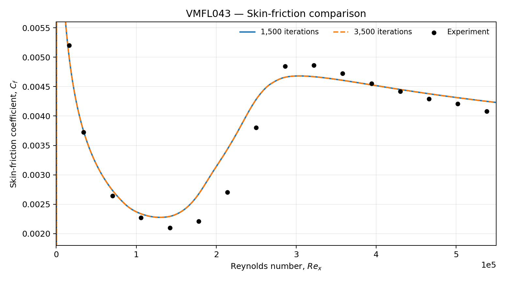

# VMFL043 — Flat-Plate Transition Benchmark

This case reproduces the ANSYS VMFL043 benchmark using the Transition SST model in ANSYS Fluent. The objective was to establish a numerical baseline for predicting laminar-to-turbulent transition over a smooth flat plate by comparing the skin-friction coefficient with the ANSYS reference solution and experimental measurements.

The simulations correspond to 1,500 iterations and an additional 2,000 iterations (3,500 cumulative iterations). The skin-friction comparison showed a mean absolute percentage discrepancy of approximately **6.34%** across 16 experimental stations.

Detailed numerical settings, results, and discussion are presented in **Section 4 of the Research Internship Report**.

## Fluent Simulation Files

**1,500 iterations**
- [Case file](cases/1500.cas.h5)
- [Data file](cases/1500.dat.h5)

**3,500 cumulative iterations**
- [Case file](cases/bl-trans-3.cas.h5)
- [Data file](cases/bl-trans-3-03500.dat.h5)

## Validation Results

Skin-friction coefficient comparison with experimental measurements.

