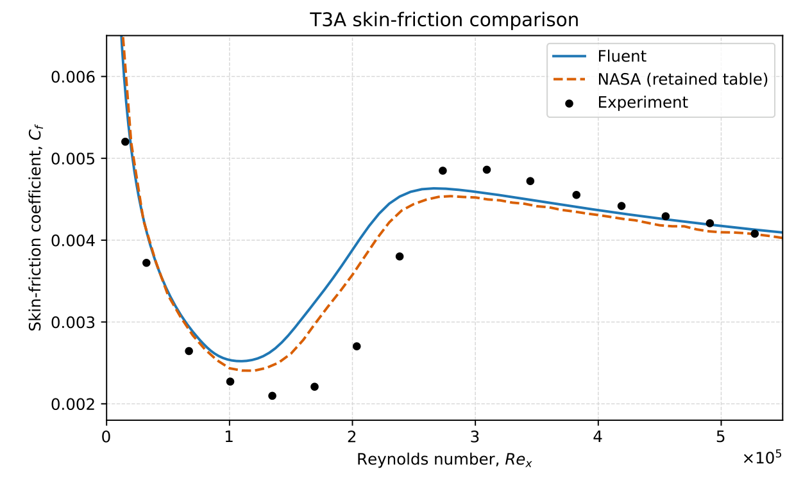
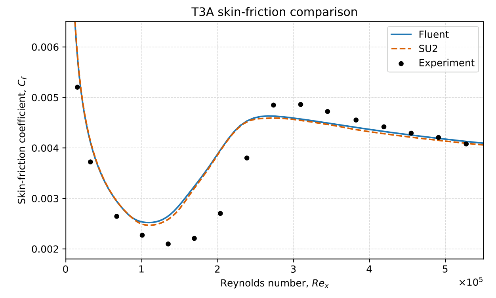
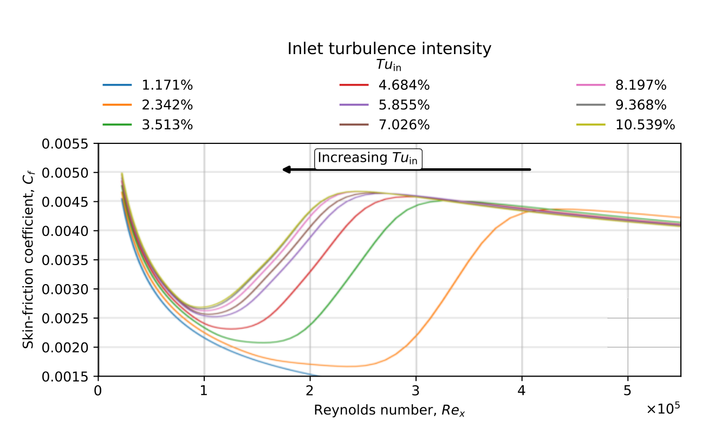
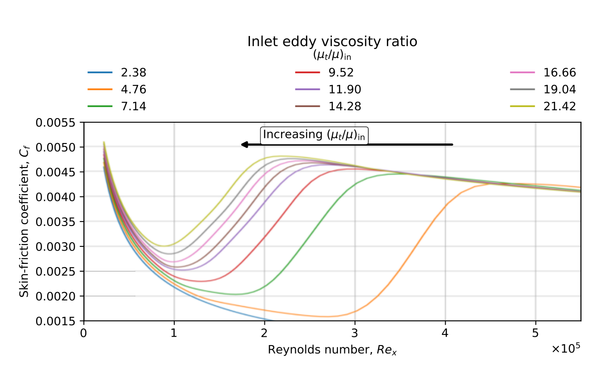
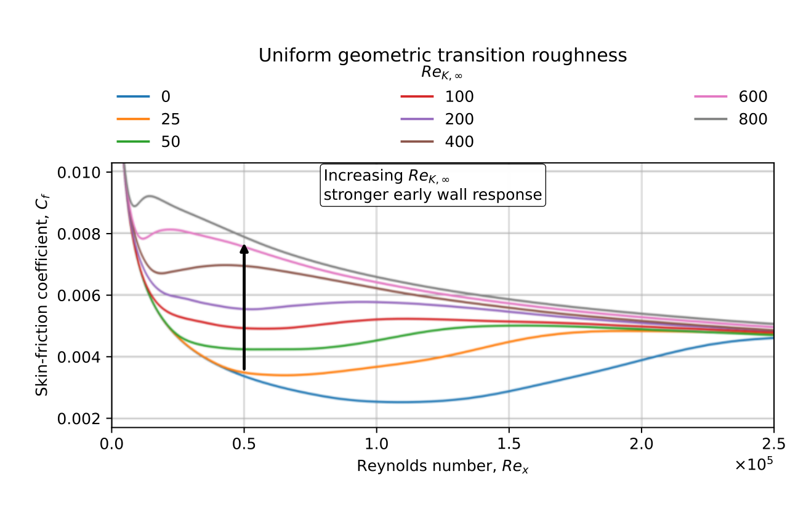
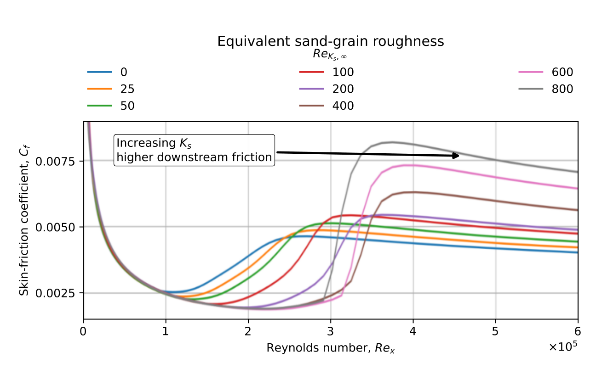
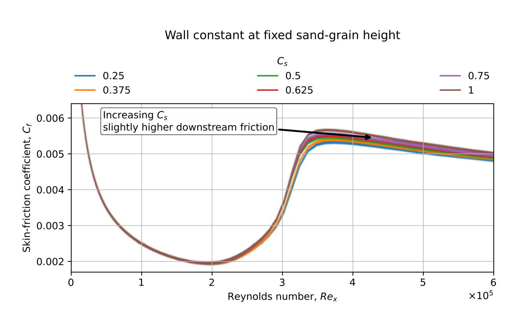

# ERCOFTAC T3A — Flat-Plate Transition and Parametric Study

This case reconstructs the ERCOFTAC T3A flat-plate transition benchmark in ANSYS Fluent using the Transition SST model. The Fluent solution was compared with NASA reference results, an independently computed SU2 solution, and experimental skin-friction measurements.

The comparisons showed mean percentage differences of **3.32% (Fluent–NASA)** and **0.913% (Fluent–SU2)**, and a mean discrepancy of **12.92% (Fluent–experiment)**.

A controlled parametric study investigated the effects of inlet turbulence intensity, inlet eddy viscosity ratio, geometric transition roughness (K), equivalent sand-grain roughness (Ks), and wall roughness constant (Cs). Each parameter was varied independently from the reference configuration.

The SU2 calculation was based on the [official SU2 T3A tutorial](https://su2code.github.io/tutorials/Transitional_Flat_Plate_T3A/) and [SU2 Tutorials repository](https://github.com/su2code/Tutorials).

Detailed methodology and results are presented in **Section 5 of the Research Internship Report**.

## Fluent Simulation Files

- [Case file](cases/final.cas_(1).h5)
- [Data file](cases/final.dat_(1).h5)

## Baseline Validation Results

**Fluent – NASA – Experiment**

**Fluent – SU2 – Experiment**

## Parametric Study Results

**Inlet turbulence intensity (Tu)**

**Inlet eddy viscosity ratio (μt/μ)**

**Geometric transition roughness (K)**

**Equivalent sand-grain roughness (Ks)**

**Wall roughness constant (Cs)**

