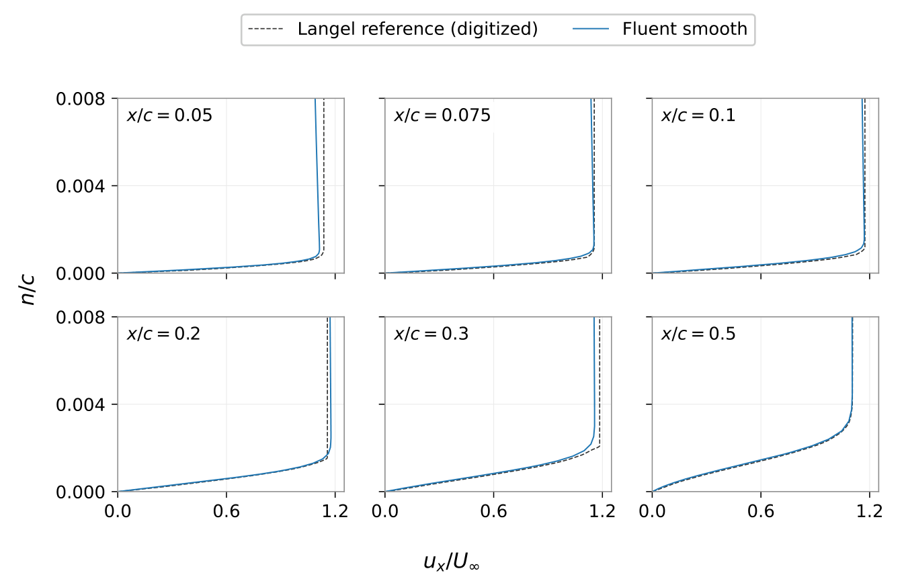
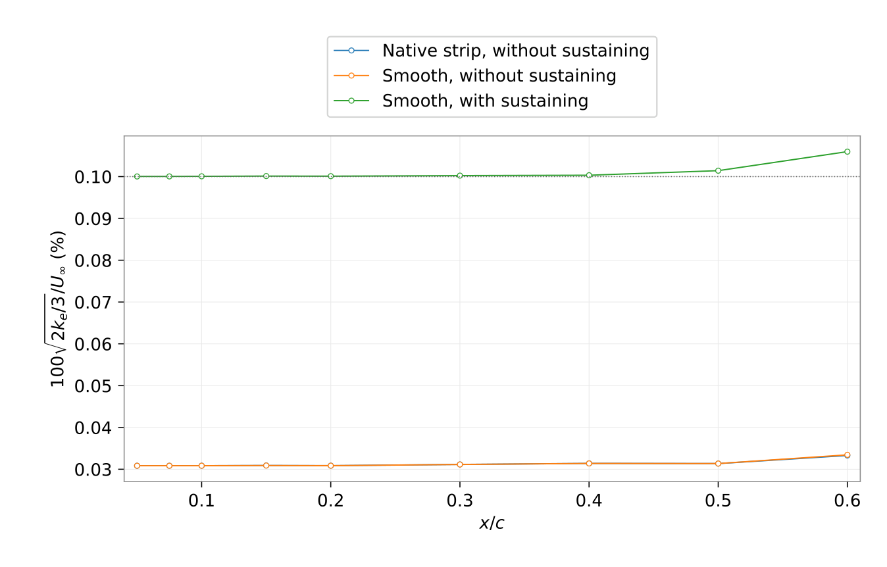
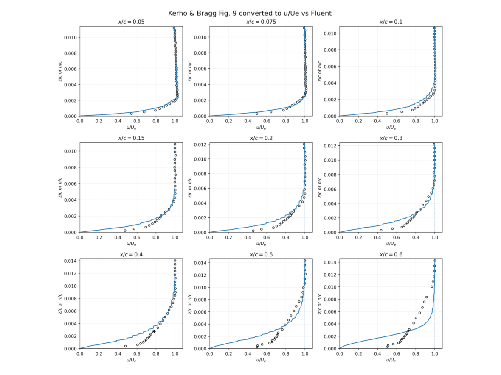
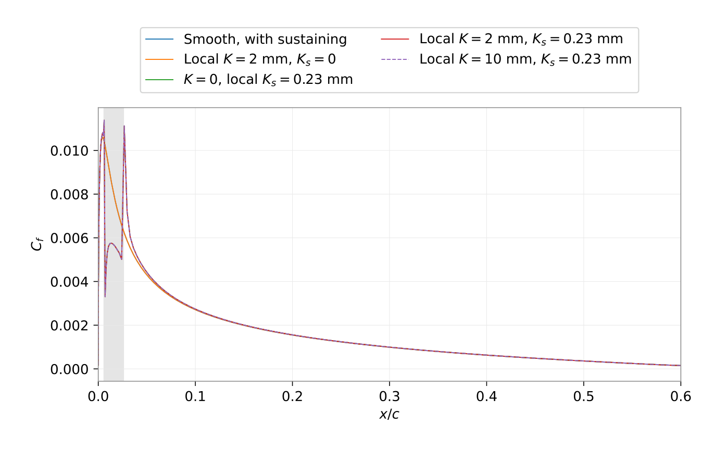
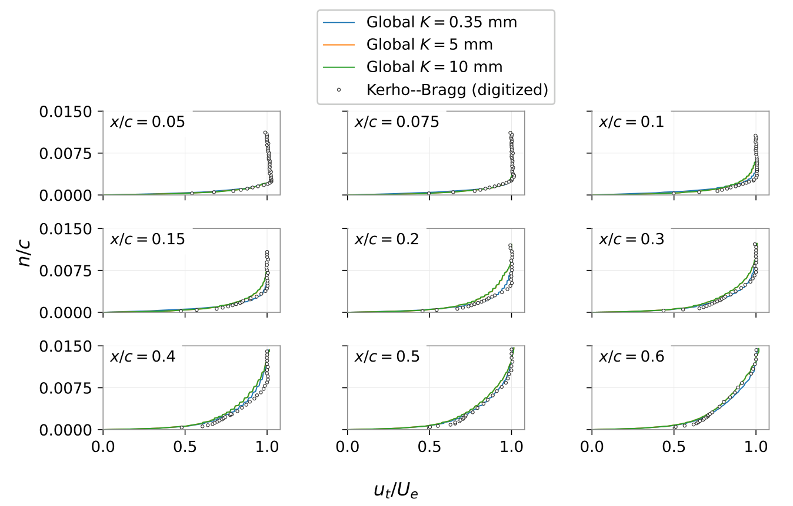
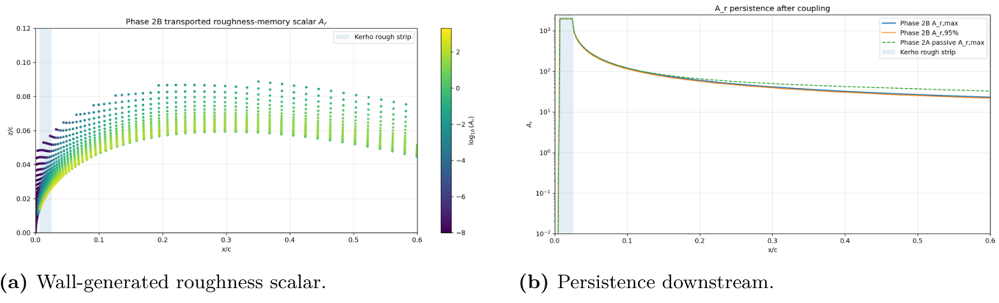
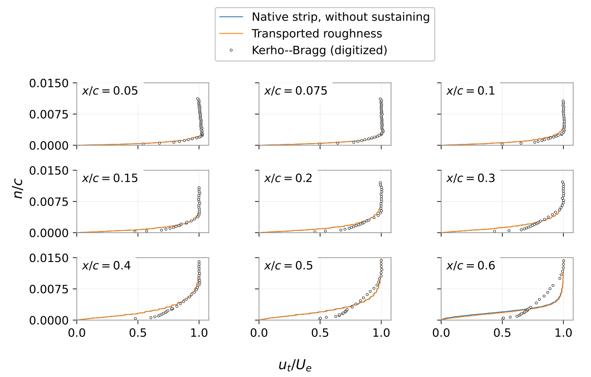
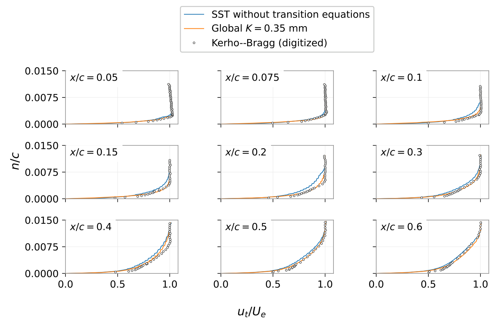
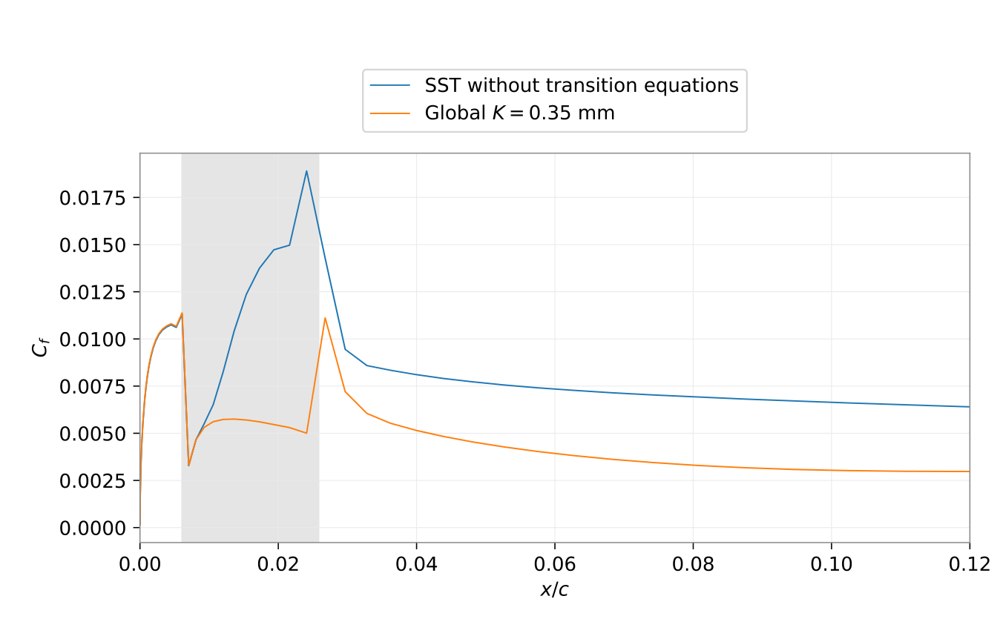

# NACA 0012 — Transition and Localized Surface Roughness Assessment

This study investigated boundary-layer transition and leading-edge roughness effects on a NACA 0012 airfoil using **ANSYS Fluent 2026 R1**. The working configuration used a chord of **0.5334 m**, a chord Reynolds number of approximately **1.25 × 10⁶**, and a **57,344-cell** one-layer extruded mesh. Smooth-wall predictions were compared with the numerical reference reported by **Langel et al.**, while rough-wall results were assessed against the **Kerho–Bragg** experimental velocity profiles.

The work first established a smooth reference and a native localized-roughness calculation, then examined freestream turbulence sustaining, separate geometric and wall-roughness inputs, globally extended transition-roughness forcing, exploratory transport of a roughness-amplification scalar (`Ar`), and standard SST without the transition equations. All configurations, comparisons, and limitations are documented in **Section 6 of the Research Internship Report**.

## 1. Smooth-Wall Reference

Transition SST with **K = Ks = 0**, without turbulence-sustaining sources. This is the unmodified reference for subsequent calculations.

- [Fluent case](cases/smoothcase.cas.h5) · [Fluent data](cases/smoothcase.dat.h5)

**Velocity profiles — Fluent smooth vs. Langel numerical reference**

## 2. Smooth Reference with Turbulence Sustaining

The same smooth geometry and Transition SST formulation, with UDF source terms for **k** and **ω** to counteract freestream turbulence decay. The ambient targets were **Tu = 0.1%** and **μt/μ = 10**.

- [Fluent case](cases/smooth_sustained/SST_SUST_FINAL.cas.h5) · [Fluent data](cases/smooth_sustained/SST_SUST_FINAL.dat.h5)
- [Sustaining UDF](cases/smooth_sustained/sst_sustain_tu01.c)

**Ambient turbulence with and without sustaining**

## 3. Native Localized Leading-Edge Roughness

Transition SST with a finite roughness strip on the **upper surface**, located at **0.00612 ≤ x/c ≤ 0.0258**. The prescribed geometric height was **K = 0.35 mm**, the equivalent sand-grain height was **Ks = 0.23 mm**, and the wall roughness constant was **Cs = 0.50**. The saved reference was calculated **without turbulence-sustaining sources**. K and Ks were imposed through distinct UDF callbacks.

- [Fluent case](cases/localized_roughness/NACA0012_KGEOM035_KS023_FINAL.cas.h5) · [Fluent data](cases/localized_roughness/NACA0012_KGEOM035_KS023_FINAL.dat.h5)
- [Localized K and Ks UDF](cases/localized_roughness/kerho_kgeom_ks023.c)

**Velocity profiles — localized roughness vs. Kerho–Bragg measurements**

Additional wall-resolution diagnostic: [native and geometric wall y+](results/rough_yplus.png).

### Localized-Roughness Sensitivity (Results Only)

Additional sustained calculations varied local K and Ks independently, including **K = 2 and 10 mm**. They are retained as results-only comparisons here; individual case/data archives for these variants are not included.

[Sustained local-control velocity profiles](results/sustained_local_profiles.png).

## 4. Global Geometric-Roughness Diagnostics with Sustaining

To test the effect of continued transition-correlation forcing downstream, a **spatially uniform geometric K** was prescribed while **Ks = 0.23 mm remained localized** on the leading-edge strip; **Cs = 0.50** and turbulence-sustaining UDF sources were retained. Global K was tested at **0, 0.35, 5, and 10 mm**. **These inputs are numerical diagnostics and do not represent the measured roughness distribution.**

| Geometric K | Fluent case | Fluent data |
|---|---|---|
| 0 mm (base) | [Case](cases/global_K_sustained/MANUAL_K_BASE_KS023_SUST.cas.h5) | [Data](cases/global_K_sustained/MANUAL_K_BASE_KS023_SUST.dat.h5) |
| 0.35 mm | [Case](cases/global_K_sustained/MANUAL_K_035mm_KS023_SUST.cas.h5) | [Data](cases/global_K_sustained/MANUAL_K_035mm_KS023_SUST.dat.h5) |
| 5 mm | [Case](cases/global_K_sustained/MANUAL_K_5mm_KS023_SUST.cas.h5) | [Data](cases/global_K_sustained/MANUAL_K_5mm_KS023_SUST.dat.h5) |
| 10 mm; Ks = 0.23 mm | [Case](cases/global_K_sustained/K10GLOBAL_KS0230UM_FINAL.cas.h5) | [Data](cases/global_K_sustained/K10GLOBAL_KS0230UM_FINAL.dat.h5) |

- [UDF used for localized Ks and sustaining in the manual-K cases](cases/global_K_sustained/kerho_ks023_sustain_only.c)

**Velocity profiles — global geometric K vs. Kerho–Bragg measurements**

*Reproducibility note:* the K = 10 mm archive references a separately named compiled UDF library (`lib_k10global_ks_sweep`); its corresponding source file was not among the recovered inputs. The UDF linked above covers the manual-K family, but should not be presumed identical to that separate library.

## 5. Exploratory Roughness Transport (`Ar`)

A user-defined scalar **Ar** was used to explore the downstream persistence of localized roughness influence. **Phase 2A** solved passive scalar transport using a prescribed strip wall condition and **σAr = 30**. In **Phase 2B**, an additional UDF source coupled Ar to the transported transition criterion. The native geometric-roughness correction was disabled; localized **Ks = 0.23 mm** remained, without turbulence sustaining.

The archived pair is the extended **Phase 2B** solution (through recorded iteration **2002**). The report examines the coupled interval **1503–1802**. This remains an **exploratory, not fully converged or validated**, model assessment.

- [Fluent case](cases/roughness_transport_Ar/KERHO_AR_PHASE2B_COUPLED_PLUS0200.cas.h5) · [Fluent data](cases/roughness_transport_Ar/KERHO_AR_PHASE2B_COUPLED_PLUS0200.dat.h5)
- [Phase 2A scalar diffusivity and wall-condition UDF](cases/roughness_transport_Ar/kerho_ar_phase2a_generated.c)
- [Phase 2B transition-coupling UDF](cases/roughness_transport_Ar/kerho_ar_phase2b_langel_source.c)
- [Localized roughness UDF referenced by the saved configuration](cases/roughness_transport_Ar/kerho_kgeom_ks023.c)

**Transported roughness scalar and downstream persistence**

**Boundary-layer profiles — native strip vs. transported roughness vs. experiment**

Additional coupling diagnostics: [transition criterion](results/ar_transition_criterion.png) · [intermittency response](results/ar_intermittency_response.png) · [turbulent kinetic-energy response](results/ar_turbulence_response.png).

## 6. Standard SST without Transition Equations

A diagnostic with the **k–ω SST** closure and **transition equations disabled**, while retaining localized **Ks = 0.23 mm**, **Cs = 0.50**, and the **k/ω sustaining sources**. This comparison examines the effect of removing explicit transition gating; it should not be interpreted as a uniformly turbulent boundary layer everywhere.

- [Fluent case](cases/fully_turbulent_SST/FULLY_TURBULENT_SST_KS023_SUST_FINAL.cas.h5) · [Fluent data](cases/fully_turbulent_SST/FULLY_TURBULENT_SST_KS023_SUST_FINAL.dat.h5)
- [Ks and sustaining UDF](cases/fully_turbulent_SST/kerho_ks023_sustain_only.c)

**Velocity profiles — SST vs. Transition SST and Kerho–Bragg measurements**

**Wall-shear response near the roughness strip**

## Scope and Reproducibility

All provided `.cas.h5` and `.dat.h5` files are native Fluent archives. Reproducing UDF-based cases requires compiling the supplied `.c` files in a compatible Fluent environment and checking that the correct callbacks are assigned; the additional K = 10 mm source dependency is noted above. The roughness-transport implementation has unresolved convergence and discretization uncertainties. **The NACA 0012 study assesses numerical transition/roughness treatments; it is not an ice-accretion or rotor-thrust prediction.**

See **Section 6 of the Research Internship Report** for computational settings, velocity normalization, profile-error metrics, residual histories, and limitations.

